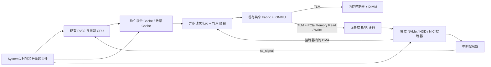

# SystemC 虚拟计算机硬件平台

当前交付范围是硬件平台。用户已确认微内核尚未实现，内核启动属于后续接入目标。
当前可运行本文验收过的裸机和用户态 ELF，尚未提供 Linux 或现成内核的启动环境，也未做架构兼容认证。

## 直接运行

在 `computer-organization-lab` 根目录执行，无需 sudo：

```bash
# 构建并进入控制台，机器初始断电
bash examples/systemc/run.sh --interactive --trace /tmp/computer

# 自动运行现有真实 RISC-V I/O 程序，并核对 512 字节数据
bash examples/systemc/run.sh --demo nvme
bash examples/systemc/run.sh --demo hdd
```

脚本使用固定的官方 SystemC 3.0.2 源码及 SHA-256，默认构建目录是
`/tmp/colab-systemc-build`，可用 `COLAB_SYSTEMC_BUILD_DIR` 覆盖。
SystemC 不是系统级服务，不需要另起进程；参考实现与应用一起编译链接。

控制台命令：

```text
on                  上电、装入程序/初始数据、保持两拍复位，然后释放复位
step                精确推进一个有效系统周期
step 10             推进十个周期
run                 连续运行，可随时输入 pause
run 1000            推进一千个周期后返回
pause               暂停整个硬件仿真时钟域
status              查看 PC、周期数、Cache 填充、总线、设备和 IRQ 状态
regs                查看 32 个通用寄存器
csrs                查看机器态 CSR，包括 mtvec/mepc/mcause/mtval
mem 0x5000 32       查看 DIMM 的物理字节；调试读取，不是 CPU load
uart-input hello    将文本字节送入客体串口的接收 FIFO，不自动添加换行
reset               清空在途事务和控制状态，CPU 回到入口；保留 RAM/存储介质
off                 断电，停止推进并取消在途事务
quit                退出
```

`run` 以小批次调用 SystemC 内核，在批次之间接收命令，不跨线程调用 `sc_start()`。
Platform API 目前只供同一仿真线程在 SystemC 内核挂起时调用，不保证线程安全。
未来 GUI 必须通过消息队列把 Power/Reset/step 等操作串行投递到该线程，不能从 GUI 线程直接调用。
暂停时不推进模拟时间，也不推进 CPU、DMA 和总线。时钟域的使能由统一控制器管理；
测试中直接调用 `sc_start()` 仍可推进全局时间，但被暂停的硬件域保持不动。

VCD 为指定路径加 `.vcd`，包含 power_good、reset、clock、PC、周期数、退休指令、
IRQ、总线阶段/请求/应答/主设备、NVMe 完成命令数及 HDD DMA 进度。
也包含 `timer_count`、`timer_pending`、`uart_rx_ready` 和 `uart_tx_ready`。
异常相关信号为 `exception_entries`、`synchronous_trap`、`mcause`、`mepc` 和 `mtval`。
可通过 GTKWave 等 VCD 查看器打开 `/tmp/computer.vcd`。

## 实际硬件数据流



正式平台入口为 `simulation/systemc/platform.hpp`。它分别实例化 CPU、指令 Cache、
数据 Cache、共享片上事务互连、设备控制器和中断控制器模块，没有调用 `SoC::tick()`。
DIMM 是被内存事务驱动的目标，不需要无意义的每拍轮询进程。
设备内部 DMA 仍由其控制器推进一次，独立的 TLM initiator 线程负责总线访问。

`QueuedTlmPort` 保留原有 `DmaBus::submit / ready / take` 接口。硬件提交请求后立即返回，
后台 `SC_THREAD` 发起 `b_transport()` 并等待响应；CPU/设备的时钟回调不会调用 `wait()`。
`TlmFabric` 复用 `Interconnect` 的 IOMMU 和 `Fabric` 的物理地址译码、排队、轮转仲裁及逐拍传输，
通过 TLM target 调用内存或设备寄存器。对 HDD、NVMe 和 NIC，主机侧通过 `PcieRequest` 扩展把完整地址的
Memory Read 或 Memory Write 交给 `PcieTarget`，再由设备端匹配 BAR 并译出寄存器偏移。MMIO 窗口取自 [板级地址表](../soc/address_map.hpp)。

CPU 取指同样来自 DIMM。`RV32Core` 新增可选指令总线和启动 PC，原有 ROM 路径保留。
平台使用共享物理地址空间，程序默认装在 `0x8000`；初始数据/常量、队列和 DMA 缓冲区在低地址。
现有小汇编器为处理程序地址保留重定位记录，避免 RAM 中的程序正文覆盖常量池或队列。

## 时间、可见性和复位

第一版是一个时钟域，默认周期 50μs，用于缩放教学实验，并非真实 CPU/PCIe 频率。
HDD 的每拍毫秒增量从该周期换算。总线和设备现有等待拍数仍需按具体研究目标校准。

每个有效时钟沿由 `PhaseClock` 按下列阶段发送事件；相邻阶段通过 delta cycle 隔开：

1. 总线推进、提交 RAM/MMIO 副作用、唤醒 TLM 响应线程。
2. 各 Cache 和设备独立推进自己的状态机，提交新的 DMA 请求。
3. 中断控制器汇总设备源，更新中断信号。
4. CPU 采样 IRQ 并推进一个周期。
5. 发布监控快照。

delta cycle 不消耗物理模拟时间。这个阶段合同保证同一阶段里各独立模块的执行顺序
不改变跨阶段响应的可见性；没有直接把多个会修改共享对象的旧 `tick()` 随意挂到同一时钟沿。
后续可在保留通信合同的基础上拆分多时钟域，而非简单修改几个 `sc_clock` 周期。

冷上电清空 RAM 并装入启动镜像，保留 NAND 和磁记录数据。复位保留 RAM 和存储介质，
取消在途总线请求、Cache 填充、DMA、设备命令及 IRQ，重建这些普通 C++ 控制对象；
SystemC 模块和端口不在运行后重建。机械盘中止当前操作，但复位/断电不把机械位置与主轴转速瞬间归零；
短暂切电重上电可以保留惯性转速。Platform 的断电域不推进 HDD，因此仅增加全局 sc_start 时间不会模拟停电滑行。
需要滑行的独立机械实验须显式推进 disk.advance；本平台不宣称完整机械/电气冷复位。
DIMM 对象也不被重建，不承诺清空其行缓冲、bank 时序或累计统计；冷启动 RAM 清零/镜像装载会正常访问 DIMM。
这与上述 CPU/设备命令/事务控制域的复位合同不同，不能据此声称全新 DDR 上电。
在途 TLM 请求带代次标识，旧响应不得落入复位后的新状态。

物理 RAM 写入会通知两个 CPU Cache 端口，更新已有缓存行和在途填充的转发字节。
通知先进入各 Cache 的 snoop 队列，由 Cache 在组件阶段自行应用，而非由内存模块直接修改其内部状态。
这复用现有写穿一致性模型，不是 MESI，也不自动实现多核一致性。

## 装入自己的机器码

```bash
/tmp/colab-systemc-build/systemc_machine \
  --bin /absolute/path/program.bin --entry 0x8000 --cycles 10000 --trace /tmp/program
```

也可装载静态 RV32 ELF：

```bash
/tmp/colab-systemc-build/systemc_machine --elf /absolute/path/program.elf --cycles 10000
```

可用 `--timed-dram` 启用 DRAM 命令状态机，用 `--dram-trcd`、`--dram-trp`、`--dram-tcas`
设置正整数周期数；`--icache-hit-cycles` 和 `--dcache-hit-cycles` 可选 1 或 2。时序模型和
调试旁路的约束见 [DRAM 时序说明](DRAM_TIMING.md)。

ELF 入口来自文件头，不接受额外 `--entry`。装载器接受小端 ELF32、RISC-V、ET_EXEC、软浮点且
无压缩指令标志的固定地址静态映像；`PT_LOAD` 段的虚拟地址须等于物理地址且位于 RAM 内。
它检查段表、对齐、重叠及入口，复制文件内容并在冷启动时清零 `p_memsz - p_filesz` 的 BSS。
拒绝动态链接、解释器、异常 ABI 标志、地址越界及其他不符合该合同的映像；不应用重定位或解析符号。
裸 RV32 二进制仍可用 `--bin` 装载，须小端、至少 4 字节且长度为 4 字节的倍数；`--entry` 同时指定装载地址和初始 PC，须 4 字节对齐，整个镜像须落在配置的 RAM 内。默认入口为 `0x8000`，默认 RAM 为 `[0, 0x40000)`。
CLI 数字参数及交互命令中的数字使用无符号十进制或 `0x` / `0X` 前缀的十六进制；十进制前导零不改变进制。
程序应自行设置栈等运行状态。
RAM 默认四 Rank、256KiB（每 Rank 64KiB），范围 `[0,0x40000)`，镜像不得越界。自定义镜像按给定周期预算运行，不要求使用示例的完成标志。

现有 CPU 支持 ADD/SUB/ADDI，AND/OR/XOR、SLL/SRL/SRA、SLT/SLTU 及其立即数形式，
LUI/AUIPC、JAL/JALR、LB/LBU/LH/LHU/LW、SB/SH/SW、六种整数条件分支、FENCE、ECALL/EBREAK，
覆盖 RV32I 的 40 条基础指令和 RV32M 的八条乘除指令；另支持六种 Zicsr 指令、Zifencei 的 FENCE.I、MRET、SRET、SFENCE.VMA 和 WFI。乘除逐拍算法和时间模型见 [RV32M 说明](rv32-muldiv.md)。
寄存器移位只采用移位量的低五位；逻辑立即数先扩展符号位，再参与位运算。
数据采用小端：LB/LH 扩展符号位，LBU/LHU 补零；SB/SH 仅写低 8/16 位，保留相邻字节。
字节可在任意地址访问，半字和字分别要求 2/4 字节对齐；未对齐访问在发起事务前产生异常。
Cache 支持三种自然对齐的访问宽度；写穿保持原宽度，对齐半字通过一个总线数据拍提交。
设备 MMIO 继续只接受对齐 32 位访问，窄访问报告故障，不通过扩大读取或读改写模拟。
平台使用多周期硬布线控制核心；原有流水线实验继续可用，但还没有共享 RAM 取指接入。
当前特权模型支持 M/S/U 三级、部分特权 CSR、PMP、中断及同步异常，详见下文。
用户态 ECALL 可以按委托设置进入机器态或监督态处理程序，再通过 MRET/SRET 返回；共享 RAM 多周期核心现已接入 Sv32/Svade。板级启动约定见 [Sv32 与启动合同](SV32_HARDWARE_CONTRACT.md)，不等于通用操作系统兼容。
因此它是后续自写微内核的硬件基础，尚不能直接运行一般编译器生成的内核镜像。

可先运行 [编译器 C 程序验收](../examples/compiler_smoke/README.md)，验证嵌套调用、栈、
字节/半字内存读写、整数计算和 UART。该程序的 ELF 由真实 Clang/LLD 生成，预期签名由 Python 独立计算。

DDR、NVMe、PCIe 均保留原有教学抽象；SystemC 不会补齐 DDR 电气/时序约束、完整 PCIe 链路，
也不会把功能模型变成逻辑门或模拟电路。更精细的时序和更多 ISA/启动设备可在此平台上继续增加。

## 机器态异常处理

SystemC 平台默认使用 `FaultHandling::MachineTrap`。此选项启用客体陷入，包含 M-mode 到 S-mode 的委托。
ECALL、EBREAK、非法指令、取指/访存访问失败和未对齐访问均进入客体异常处理程序，普通故障不会直接停止模拟器。
目标为 M-mode 时，异常写入 `mepc`（故障指令地址）、`mcause`、`mtval`，将 MIE 保存到 MPIE 并清除 MIE。
故障指令不退休，后续推测指令及其未提交访存被清除；GPR 和栈由处理程序自行保存。
MRET 恢复中断使能并跳转到 mepc；处理程序若希望跳过故障指令，须自行将 mepc 加 4。
异常不受 MIE 屏蔽。mtvec 的 Direct 和 Vectored 模式下，同步异常都进入 BASE；
Vectored 的 BASE+4×cause 仅用于异步中断。这遵循
[RISC-V 机器态规范](https://docs.riscv.org/reference/isa/v20260120/priv/machine.html)。

| cause（不含中断位） | 异常 | 本平台 mtval |
|---|---|---|
| 0 / 1 | 指令地址未对齐 / 取指访问失败 | 目标或访问地址 |
| 2 | 非法指令或不支持的 CSR | 原始机器字 |
| 3 | EBREAK 断点 | 0 |
| 4 / 5 | Load 未对齐 / 访问失败 | 访存地址 |
| 6 / 7 | Store 未对齐 / 访问失败 | 访存地址 |
| 8 | 用户态 ECALL | 0 |
| 9 | 监督态 ECALL | 0 |
| 11 | 机器态 ECALL | 0 |
| 12 / 13 / 15 | Sv32 或原教学 MMU 的取指 / Load / Store 页面故障 | 原始虚拟地址 |

教学 MMU 的权限/驻留失败按访问类型传入页面故障；页表本身无法访问则传入访问故障。
原教学 MMU 与客体 RAM 页表驱动的 Sv32 是两条独立路径；Sv32 范围见下文及启动合同。机器态寄存器包括 `mscratch` 和可读写 `mtval`。
外部中断使用 mcause=0x8000000b；软件/定时中断分别为 0x80000003/0x80000007，进入时 mtval 清零。
`IRQs` 统计机器态及监督态中断的入口总数，`exceptions` 单独统计同步异常。

程序须先设置 mtvec 并准备处理程序。复位后的 mtvec=0 是合法入口，发生异常将跳到 0；
未安装处理程序时可能持续异常，控制台可通过 `csrs` 和异常次数观察。
独立教学 Core 默认使用 `HostException` 以保留逐拍报错实验；构造时可选择 `MachineTrap`。
Platform 构造函数的最后一个参数可显式选择 HostException，供故障诊断测试使用，复位保留所选策略。
CPU 控制线冲突等未归类为指令/翻译故障的实现错误继续报告为宿主错误。

## M/S/U 特权态和物理内存保护

CPU 复位进入 M-mode。机器态软件配置 mepc 和 mstatus.MPP=U/S 后执行 MRET，进入用户态或监督态。
进入 M-mode 的异常/中断保存原特权级到 MPP；MRET 恢复该级别，将 MPP 置 U、MPIE 置 1。
返回 S/U-mode 时清除 MPRV；M-mode 设置 MPRV 且 MPP=U/S 时，数据访问按所选权限检查，取指仍按 M-mode。
MPP 接受 U/S/M；保留编码 2 按 WARL 映射为 U。S/U-mode 使用机器态 CSR 或 MRET 会产生非法指令异常。
较低特权级的机器中断由 mie 中的局部使能控制，不受 mstatus.MIE 屏蔽。

物理内存保护实现 16 个 PMP 表项、4 字节粒度、32 位物理地址，支持 OFF/TOR/NA4/NAPOT、R/W/X 和 L。
对应 RV32 CSR 为 pmpcfg0～3、pmpaddr0～15；程序通过六种 Zicsr 指令访问。
第一个匹配任意访问字节的表项必须覆盖整个访问；部分覆盖直接拒绝，不继续尝试后续表项。
S/U-mode 未匹配任何项时拒绝；M-mode 未匹配或匹配未锁项时允许，匹配锁项时检查权限。
L 位锁定配置与地址，锁定的 TOR 项还锁定前一项地址所定义的下界；复位才解除锁定。
保留的 R=0/W=1 配置按 WARL 清除 W；PMP 地址仅保留物理地址实现所需的低 30 位。
规则依据 [RISC-V 官方特权规范的 PMP 章节](https://docs.riscv.org/reference/isa/v20250508/_attachments/riscv-privileged.pdf)。

CPU 在提交取指/数据请求前检查 PMP；共享内存路径先翻译地址，再检查物理范围，然后进入 Cache。
命中 Cache 也不能绕过检查。PMP 拒绝产生对应访问故障；mtval 保留原虚拟访问地址。
教学分页按当前或 MPRV 指定的有效权限检查 U 位，仍沿用原教学页表格式。
PMP 用于 CPU；DMA 的访问保护继续由 IOMMU 负责。

控制台 `status` 显示 mode=M/S/U；`csrs` 显示两组陷入 CSR、委托状态和示例所用 PMP 寄存器。
VCD 的 `privilege` 为 3（M）、1（S）或 0（U）。可运行
[用户态 C/PMP 验收](../examples/compiler_smoke/README.md#用户态-c-程序与-pmp-隔离)，
验证实际用户程序、独立机器态栈、ECALL 返回及对内核/设备访问的拒绝。

## 监督态异常委托与返回

机器态通过 medeleg（0x302）选择交给 S-mode 的同步异常；可写 cause 为 0～9、12、13、15，
机器态 ECALL 和保留位保持 0。只有 S/U 来源的异常可以进入 S-mode，M-mode 异常始终留在 M-mode。
监督态 ECALL 为 cause=9，可以进入 M-mode 服务；软件也可选择将其委托给 S-mode。

S-mode 陷入使用独立的 sepc/scause/stval，保存原 S/U 级别到 SPP，将 SIE 保存到 SPIE 并清除 SIE；
它不改写 mepc/mcause/mtval 或 MPP/MIE/MPIE。SRET 根据 SPP 返回 S/U，恢复 SIE，
将 SPIE 置 1、SPP 置 U 并清除 MPRV。因此 U → S → M 可以按 MRET → SRET 返回，
GPR 与三套栈的保存/恢复由客体代码完成。

| CSR | 地址 | 本实现的行为 |
|---|---|---|
| sstatus | 0x100 | mstatus 的 SIE/SPIE/SPP/SUM/MXR 别名；写入不改变机器态字段 |
| sie / sip | 0x104 / 0x144 | 只显示 mideleg 已委托的中断位；sie 可写，sip 仅 SSIP 可写 |
| stvec | 0x105 | Direct/Vectored；保留 mode 映射为 Direct |
| sscratch / sepc / scause / stval | 0x140～0x143 | 可读写；sepc 低两位清零 |
| scounteren / senvcfg | 0x106 / 0x10a | 固定为 0；禁用下级计数器访问、无额外可选环境控制 |
| satp | 0x180 | Bare / Sv32，9 位 ASID、22 位 PPN；写入不隐式刷新 TLB |
| medeleg / mideleg | 0x302 / 0x303 | 同步异常与中断的委托掩码；mideleg 只接受 bit 1/5/9 |
| mcounteren | 0x306 | 固定为 0，尚未提供 cycle/time/instret CSR 读取 |

本平台提供 SSIP/STIP/SEIP（cause=1/5/9），由 M-mode 写 mip 设置或清除；
机器态 MSIP/MTIP/MEIP 继续来自硬件输入。S-mode 只能通过 sip 修改已委托的 SSIP，
STIP/SEIP 的确认需要机器态服务。CLINT 不直接生成 STIP；编译器实验的 M-mode 固件
在 MTIP 发生后设置 STIP，再由 S-mode 处理程序请求 M-mode 清除。

中断同时要求 pending 和局部使能。未委托的中断目标为 M-mode，较低级运行时忽略 MIE；
委托后的中断在 M-mode 屏蔽，在 S-mode 要求 SIE，在 U-mode 忽略 SIE。
目标 M-mode 的中断优先于目标 S-mode；同一目标按外部 → 软件 → 定时排列。
stvec.Vectored 的监督态中断入口为 BASE+4×cause，同步异常始终进入 BASE。

mstatus.TVM/TW/TSR 可由 M-mode 设置，分别拦截 S-mode 的 satp/SFENCE.VMA、WFI 和 SRET，
产生精确非法指令异常；M-mode 不受这三位拦截。TW 的实现选择立即报告异常。
U-mode 的 SRET/SFENCE.VMA/WFI 及 S-mode CSR 访问非法。
SFENCE.VMA 在较早访存确认后退休，并串行化后续取指；不写 GPR，不实现远端 hart 操作。
Sv32 TLB 按 rs1/rs2 选择地址/ASID 失效：rs1=x0 表示所有地址，rs2=x0 表示所有 ASID（含 global）；
rs2 非 x0 时只失效该 ASID 的非 global 项。非 x0 寄存器值为零仍选择 VA=0 / ASID=0。
原教学 TLB 没有 ASID，继续保守全刷；两套可配置组相联组织及超级页策略见 [TLB 组织](TLB_ORGANIZATION.md)。

共享 RAM 的多周期核心支持 Sv32 两级 RAM 页表、4KiB/4MiB 页、SUM/MXR/MPRV、ASID/global 和 Svade 缺 A/D 页故障。
页表读取实际经过数据 Cache/TLM/DIMM，隐式访问受 S-mode PMP 检查；最终物理访问也不能绕过 PMP。
32 位物理平台拒绝不可达的 34 位 PPN，不截断为低地址。写 satp 不隐式 fence；SFENCE 失效覆盖匹配的整个叶映射。
Bare 模式仍不提供 S/U 页级隔离；原教学 MMU 保留供旧实验使用，不作为 Sv32 支持证据。
旧 ROM 流水线未接共享取指/走表，尝试在该配置启用分页会明确报不支持，不静默按物理地址执行。
委托和返回规则依据 [RISC-V 官方监督态源码](https://github.com/riscv/riscv-isa-manual/blob/main/src/priv/supervisor.adoc)
及[机器态源码](https://github.com/riscv/riscv-isa-manual/blob/main/src/priv/machine.adoc)。

可运行[监督态 C 程序验收](../examples/compiler_smoke/README.md#监督态-c-程序与-msu-嵌套陷入)。
VCD 增加 scause/sepc/stval，复位清空监督态寄存器、委托设置和软件挂起位。

## CSR 指令与内存屏障

六种 CSR 指令共用一次读改写路径：CSRRW/CSRRS/CSRRC 的源为寄存器，
CSRRWI/CSRRSI/CSRRCI 的源为零扩展的 5 位 uimm，uimm 不读取同编号 GPR，也不建立寄存器相关。
CSRRW[I] 的 rd=x0 时不读 CSR；CSRRS/CSRRC 的 rs1=x0、CSRRSI/CSRRCI 的 uimm=0 时不写 CSR。
寄存器编号非零但其中的值为 0，仍会尝试写入；因此对只读 CSR 的这种操作会产生非法指令异常。
检查权限、读旧值、写新值和 GPR 写回作为同一条指令的提交动作，失败不部分写回。
规则见 [RISC-V Zicsr 规范](https://docs.riscv.org/reference/isa/unpriv/zicsr.html)。

misa 为固定 WARL 值 `0x40141100`，表示 RV32、I、M、S、U，写入不改变 ISA；
mvendorid/marchid/mimpid/mhartid/mconfigptr 均读为 0，身份 CSR 的写入非法。
这些值仅描述当前单核教学实现，不表示已经过架构认证。

当前 CPU 只有一个在途数据访问，写穿完成且总线确认后才退休。
FENCE 将所选前驱/后继集合保守地视为完整屏障；它等待本核先前访问确认，不等待无关 DMA 全部完成。
流水线在屏障 WB 时清除预取状态，再从下一条指令重新取指；多周期核心本来就逐条完成后再取指。
FENCE.I 保证先前已可见的代码写入能被本核后续取指观察到：SystemC 平台沿用已有物理写监听，
更新驻留指令 Cache 的相应字节，并在屏障前完成较早写入，因而无需另造一份失效消息。
平台的单核写穿/写更新顺序强于指令要求；未执行 FENCE.I 时也可能读到新代码，软件不应据此依赖更弱的平台。
FENCE 与 FENCE.I 均允许在 U-mode 执行，不会改变 GPR；未使用的 rd/rs1 字段忽略，保留 fm 按完整 FENCE 处理。
语义依据 [RV32I 内存顺序章节](https://docs.riscv.org/reference/isa/unpriv/rv32.html) 和
[Zifencei 规范](https://docs.riscv.org/reference/isa/unpriv/zifencei.html)。

整机用例 `fence_i` 先执行并缓存函数旧版本，再通过 CPU Store 修改指令、执行 FENCE.I 并调用新版本。
`fence_dma` 验证 CPU 写数据 → FENCE → NIC 命令 → DMA 读取并回写的实际总线路径。
原流水线仍使用不可变程序 ROM，其 FENCE.I 验证覆盖前端串行化；运行中代码修改由共享 RAM 的 SystemC 平台验证。

## CLINT 兼容本地中断与 WFI

平台新增单核 CLINT 兼容寄存器窗口，基址 `0x02000000`。它有自己的 SystemC 组件过程，
在组件阶段推进时间并发布 MTIP/MSIP 信号，CPU 在后续 CPU 阶段采样。
本地中断直接进入 CPU，设备外部中断继续经过原有中断控制器。

| 偏移 | 寄存器 | RV32 访问与语义 |
|---|---|---|
| 0x0000 | MSIP0 | 32 位，只有 bit 0 有效；写 1/0 置位/清除软件中断 |
| 0x4000 / 0x4004 | MTIMECMP0 低/高 32 位 | 组合成无符号 64 位比较值 |
| 0xbff8 / 0xbffc | MTIME 低/高 32 位 | 组合成无符号 64 位计数，每个有效平台周期递增 1 |

只接受对齐的 32 位 MMIO；未实现的偏移和其他 hart 的寄存器拒绝访问。
mtime 复位为 0、mtimecmp 复位为 UINT64_MAX、MSIP 复位为 0；mtime 溢出按 2⁶⁴ 回绕。
默认周期 50μs，对应教学平台 timebase=20000Hz，`status` 和 `Platform::timebase_hz()` 可查看。
修改平台周期也会改变此 timebase；这不是固定 10MHz 的板级模型，尚未提供设备树启动信息。
WFI 等待期间时间继续推进，调试器 Pause、复位保持及断电期间整个有效硬件域停止推进。

mtime>=mtimecmp 时 MTIP 持续置位，软件应将比较值移到未来以清除；没有 PLIC Claim/Complete 操作。
RV32 通过“低位写 -1 → 写高位 → 写低位”更新比较值，以避免中间值引起提前中断。
mtime 读取可采用“高 → 低 → 高”并在高位变化时重试；各次 MMIO 访问没有隐含 64 位快照或原子性。
寄存器布局沿用 [RISC-V 架构测试中的 CLINT 地址约定](https://github.com/riscv/riscv-arch-test/blob/act4/config/sail/sail-rv64-max/rvmodel_macros.h)，
计时、中断电平与 WFI 规则依据 [RISC-V 机器态规范](https://docs.riscv.org/reference/isa/priv/machine.html)。

mie/mip 支持 MEIE/MEIP(bit 11)、MSIE/MSIP(bit 3)、MTIE/MTIP(bit 7)。三类输入都是硬件电平，
写 mip 不能确认中断；同拍优先级为外部 → 软件 → 定时。
Vectored 入口分别为 BASE+44、BASE+12、BASE+28；Direct 模式都进入 BASE。

WFI 允许 M/S-mode，S-mode 受 TW 拦截；U-mode 执行产生非法指令异常。
WFI 在完成先前指令后退休一次，PC 指向下一条指令，然后停止取指和年轻访存；
CPU 继续记录有效时钟及 `wfi_wait_cycles()`，不再增加退休指令数或总线等待计数。
局部已使能的中断变为 pending 时唤醒，与全局 mstatus.MIE 无关。
目标级别的全局使能及委托允许时进入处理程序，mepc/sepc 保存 WFI 的下一条指令；
否则从该指令继续执行，不发生陷入。
局部未使能的 pending 输入保持可见，但本实现继续等待。
DMA、存储、串口及 CLINT 的组件过程继续由平台时钟驱动。

控制台显示 `waiting=wfi/no`、`WFI cycles`、mtime 和 timebase；VCD 新增 cpu_waiting、
wfi_wait_cycles、mtime、mtimecmp、mtip、msip。原 `irq_pending` 仅表示外部中断控制器的输出。
`clint_timer` 整机测试在 CPU 等待时完成 NIC DMA，再由定时器唤醒并验证 ISR/MRET；
`clint_software` 和 `wfi_masked_global` 分别验证软件中断及全局 MIE 关闭时的无陷入唤醒。
`clint_reset` 在 WFI 等待且存在未使能的软件中断时复位，验证等待状态、计数器及中断输入清空，
下一周期不会触发残留中断。

## 教学定时器

定时器位于 MMIO 基址 `0x40000000`，只接受对齐的 32 位访问，通过中断控制器的源 4
触发 CPU 的机器态外部中断；这不是 RISC-V CLINT/`mtime` 机器定时器。
每个有效硬件周期计数一次，暂停和复位期间不计数，周期的真实模拟时间由平台时钟决定。

| 偏移 | 寄存器 | 行为 |
|---|---|---|
| `0x00` | COUNT | 当前计数；只允许在停用时写入 |
| `0x04` | COMPARE | 正数阈值；只允许在停用时写入 |
| `0x08` | CONTROL | 位 0 启用、位 1 周期模式、位 2 中断输出使能 |
| `0x0c` | PENDING | 位 0 为锁存的到期状态，写 1 清除 |

计数达到阈值时锁存 PENDING。单次模式自动停用；周期模式清零计数并继续运行，
但 PENDING 不累计到期次数，软件须及时确认。清除 PENDING 后还应向中断控制器写入
相应的 Complete；复位清空定时器状态。计时器不会在中断屏蔽时丢掉已锁存的到期状态。

## 教学串口

串口使用 `0x40001000` 起始的对齐 32 位 MMIO 和中断控制器的源 5；它是教学设备，
不兼容 16550 等现成 UART 驱动。寄存器：`DATA`（偏移 0，读出一个接收字节或写入一个发送字节）、
`STATUS`（偏移 4，位 0 接收就绪、位 1 发送 FIFO 有空位、位 2 发送 FIFO 空）、
`CONTROL`（偏移 8，位 0 接收非空中断、位 1 发送 FIFO 空中断）。中断是电平触发，
接收 FIFO 排空或关闭相应使能可撤销中断。

收发 FIFO 各容纳 16 字节，接收注入超限会整体失败，发送写满或读空接收 FIFO 会报告访问错误。
发送每字节需四个有效系统周期；宿主输出缓冲上限 4096 字节，满时发送停止并向 FIFO 反压，
宿主读走输出后继续，不静默丢弃字节。控制台运行时分批显示输出；`uart-input` 注入文本时
不会自动添加换行。平台复位清除 FIFO、输出缓冲和控制状态。

## 验证

```bash
ctest --test-dir /tmp/colab-systemc-build --output-on-failure
bash tests/run_io.sh
bash tests/run_pipeline.sh
bash tests/run_cpu_cache.sh
bash tests/run_control_units.sh
```

SystemC 测试覆盖信号延迟、供电/复位握手、TLM 延迟、真实 RAM 取指、CPU 访存等待、
NVMe 队列/DMA、HDD DMA/ISR/MRET、CPU/NVMe/HDD/NIC 共享仲裁、暂停/单步、
DMA 写入已有 CPU 缓存行、在途复位、IOMMU 拒绝写入、冷热复位数据保留，
以及非法指令/取指越界的精确退休边界。
另保留 `ClockedSoC` 整机桥接示例，用于对照旧模型；正式平台测试不依赖该桥接。

验证使用 GNU C++ 13.3 / C++17。开启 `COLAB_COMPILER_SMOKE_TEST` 后包含真实编译 ELF 验收，
新增 `sv32_translation`、`systemc_sv32_lifecycle`、`systemc_compiled_paged` 三项；最新实测结果见 [阶段记录](SV32_STAGE_RESULTS.md)。
不能用修改前的 56 项记录证明新代码通过。
独立 Core 测试覆盖两种多周期控制器和流水线开启/关闭转发下的字节/半字访问、
精确异常、嵌套异常、MRET、页表失败及年轻指令副作用清除。
九个 SystemC 异常场景验证实际 RAM 取指、TLM、异常现场写回、UART 输出及复位。
Clang/LLD 生成的 C 程序实际执行窄访存、嵌套调用、栈、CLINT/WFI 定时唤醒及 ECALL/处理程序/MRET，
产生签名 `0x9935510a`，定时中断和同步异常各 1 次，SP 恢复到 `0x10000`，UART 输出 `C`。
VCD 提供异常脉冲、计数、mcause、mepc、mtval，以及新增 satp/page_walks/page_table_reads/page_faults 信号。
该程序的波形还记录了 1842 个 WFI 等待周期：mtime 递增，PC 和退休指令数保持不变，
随后出现 MTIP 与定时中断 cause；返回地址等于 WFI 后的指令地址。
用户态 Clang C 程序产生签名 `0x50524f54`，六次异常依次为用户 ECALL、非法 CSR、
设备读取拒绝、内核写入拒绝、内核取指拒绝、用户 ECALL；验证器检查 ELF 中的 PC、MPP、
保护数据、独立用户/机器态栈、串口输入保留和 PMP 复位。VCD 同时确认 M/U 模式转换。
PMP 单测以独立区间参照覆盖 TOR/NA4/NAPOT、权限、首项优先、整访问匹配、锁定和 32 位边界。
Zicsr 测试覆盖全部六种形式、CSR 读写副作用抑制、只读地址、操作数别名和用户态拒绝。
屏障测试覆盖延迟访问顺序、流水线冲刷、保留字段及 U-mode；整机另验证已缓存代码的修改与 NIC DMA 顺序。
Clang 生成的机器态/用户态程序也实际执行了 CSR 立即数形式和 FENCE/FENCE.I。
CLINT 单测覆盖 RV32 分步比较值写入、时间回绕及非法偏移；WFI 单测覆盖四种 CPU 配置、
三类中断、全局使能和向量模式组合，以及错误路径、局部屏蔽、U-mode 拒绝和中断优先级。
监督态单测覆盖四种 CPU 配置的异常委托、嵌套陷入、CSR 别名、PMP 拒绝、SRET、
TVM/TW/TSR、SFENCE.VMA、WFI，以及各特权级/全局使能/中断委托组合。
监督态 Clang 程序产生签名 `0x53555052`、六次异常和两次中断，实际运行
CLINT → M-mode 转发 → S-mode 定时处理、U → S C 函数 → M 服务 → U 及非法 CSR 恢复。
该程序的 VCD 确认 M/S/U 转换、监督态 cause=2/8/0x80000005，以及 720 个 S-mode WFI 空等待周期。
以上验证不等于完整 RISC-V 特权架构或操作系统兼容性认证。

位运算、移位量低五位及符号扩展的指令规则见 [RV32I 规范](https://docs.riscv.org/reference/isa/unpriv/rv32.html)。

ELF 装载约定依据 [ELF gABI 程序头规范](https://gabi.xinuos.com/elf/08-pheader.html) 和
[RISC-V ELF ABI](https://docs.riscv.org/reference/abi/riscv-elf-object-files.html)。

依赖用法依据 [Accellera SystemC 的安装和 CMake 接入说明](https://github.com/accellera-official/systemc/blob/3.0.2/INSTALL.md)，
TLM 接口见 [SystemC / TLM 规范入口](https://systemc.org/resources/standards/)。
