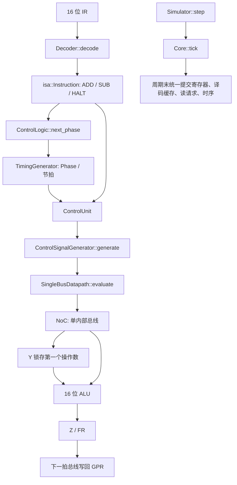

> 历史实现检查快照。下文提到的 MIPS 专用单周期与独立流水代码已在 RV32 流水整合时移除；
> 当前实现见 [RV32 流水线](../soc/core/pipeline/README.md)，这些历史文件名不再是可用入口。

# 阶段 1：控制器与数据通路检查

检查基于本次修改前的工作树；已有未提交的硬件模块与测试均保留。

## 当前真实执行流程

`Core::tick()` 调用 CU 取得本拍控制线，组合求数据通路下一状态，必要时对新锁存 IR
译码，调用 ControlLogic 决定下拍，再统一提交。三个 CU 子模块已经是硬布线控制器：
控制线来自指令与状态的 switch/组合逻辑，不读取控制存储器。
FR 由数据通路锁存，但原 ADD/SUB/HALT 序列尚无消费标志的条件分支。

| 文件 | 检查结论 |
|---|---|
| `soc/core/decoder/decoder.hpp` | 原接口只译码 16 位自定义教学指令，不能把它称作 RV32I |
| `soc/core/control_unit/control_unit.hpp` | 组织时序、组合控制线、下拍逻辑，未提供模式选择 |
| `control_logic/control_logic.hpp` | 七拍取指、操作数、执行、写回的硬布线有限状态机 |
| `control_signal_generator/control_signal_generator.hpp` | PCout/MARin/Read/MDRout/IRin/Yin/Zin/GPRin 等实际控制线 |
| `timing_generator/timing_generator.hpp` | 每次脉冲推进一拍，记录指令/阶段节拍；异常时不推进 |
| `datapath/dedicated/control.hpp` | MIPS 教学子集的单周期组合控制译码，不是 RISC-V Decoder |

原单总线取指：PC→MAR 一拍，Read 五拍，MDR→IR 一拍，共七拍；ADD/SUB 再三拍。
原专用通路：`SingleCycleDatapath::tick → evaluate → InstructionFields::decode →
ControlDecoder::decode → LoadStoreDatapath::evaluate → ALU`，一拍组合完成后提交。
两条路径原先彼此独立，不能将 MIPS 的 16 位立即数、PC+4 后分支偏移或溢出陷阱语义
直接套到 RISC-V 上。

## 在现有代码上的实施边界

保留原 16 位 `Core`、MIPS `SingleCycleCore` 及三个 CU 子模块；新增 `RV32Core`。
对既有 CU 子模块增加 RV32 重载，硬布线控制器直接组合使用它们，避免复制一套状态机。
RV32 两种控制模式共用 `Decoder::decode_rv32` 与逐拍 `RV32Datapath`；后者复用现有
32 位 ALU、32×32 寄存器堆和数据存储器。微程序模式独立读取 CM，不调用硬布线状态转移
或控制信号生成器。每次 tick 只提交一拍，公共取指程序从微地址 0 开始。

阶段 2～6 的接口、时序、验证结果见 `docs/control-unit.md`（实现后补充）。
