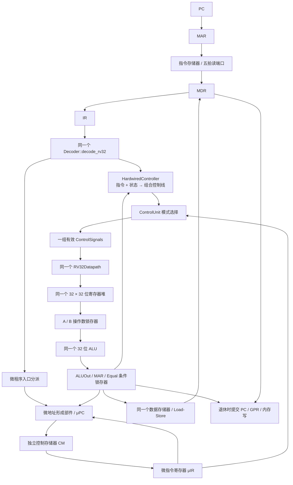

# 硬布线与微程序控制器

阶段 1 的原实现检查与真实执行流程见 [检查记录](control-unit-audit.md)。
本页说明 `RV32Core::Execution::MultiCycle` 下的硬布线/微程序对照实验，并保留原 16 位 `Core`。
整机默认采用 [RV32 流水线](../soc/core/pipeline/README.md)；多周期实验需显式配置
`SoCConfig.cpu_execution = RV32Core::Execution::MultiCycle`。两种多周期控制器执行相同的 RV32 机器字。

## 共用的机器结构



`decoder/instruction.hpp` 中的 `DecodedInstruction` 保存操作类型、rd/rs1/rs2、
有符号立即数、opcode/funct3/funct7 和原始机器字。I/S/B 立即数在共享 Decoder 中还原。
保留 `decode(uint16_t)` 供旧 Core 使用；RV32 显式调用 `decode_rv32(uint32_t)`，避免
旧调用的整数常量被新的重载意外解释成另一种 ISA。

`control_unit/control_signals.hpp` 集中定义控制接口。RV32 控制线位于
`control_unit::rv32`，旧单总线信号保留原类型。`control_interface.hpp` 定义初始化/reset、
本拍 signals、边沿 clock、完成状态、指令边界和时序统计。
`HardwiredController` 与 `MicroprogrammedController` 实现同一个接口。

两个控制器只输出控制线；共享数据通路不按 `Operation` 分派执行。
`RV32Datapath` 复用现有 `dedicated::ALU`、`RegisterFile`、`InstructionMemory`、
`DataMemory`，增加跨拍锁存器；这些基础部件也由 RV32 流水线复用。
`control_logic/`、`control_signal_generator/`、`timing_generator/` 保留旧逻辑，
增加 RV32 版本，由硬布线控制器直接调用。微程序控制器只读 CM，独立决定控制输出与下址。

## 一拍的含义与公共取指

`RV32Core::tick()` 只执行当前一拍：从旧状态取控制线与数据，完成校验，在边沿
提交锁存器和控制器下址。`step_instruction()` 是宿主的有界逐拍循环，便于运行到退休；
它不是在一次 `tick()` 内执行整段微程序。

公共取指保持图片所示的七拍：

| 拍 | 动作 | RV32 控制线 |
|---|---|---|
| T1 | PC → MAR | `mar_from_pc` |
| T2 | 发起主存读，保存端口响应快照 | `instruction_read` |
| T3～T5 | 读请求等待 | `instruction_read` |
| T6 | 响应 → MDR | `instruction_read`, `instruction_to_mdr` |
| T7 | MDR → IR | `ir_in` |

从 T2 到 T6 的 Read 共五拍。等待拍不会向 IR/GPR 提前写入响应。
程序和数据 RAM 是两个独立的理想功能模型；数据 LOAD 同样采用五拍读端口，STORE
在退休拍完成一次已校验的边沿写入。CM 不共用这两个 RAM。

硬布线在 T7 锁存 IR 后组合译码，T8 读操作数。微程序在 T7 后还有一拍 Dispatch，
从 IR 译码并选择执行微程序入口。两者的架构 PC 均在退休时提交，故障时仍指向当前指令。
PC+4 和分支 PC+立即数有专用下地址路径，不占执行 ALU；这是本实验的数据通路约定。

## 控制存储器、μPC 与 μIR

CM 有 256 个概念微地址槽，按所实现的指令装载微指令。C++ 结构体是功能模型，不把
`sizeof(Microinstruction)` 当作真实控制字位宽。控制器构造时复制 ROM 映像，运行时只读；
`ControlStore::set()` 用于构造不同实验映像。

`Microinstruction` 包含操作控制字段和顺序控制字段。操作控制采用水平型组织：
独立布尔使能允许相容微操作并行，ALU 功能/输入/写回来源用互斥选择字段编码。
因此它对应水平型中的直接使能与字段编码组合，没有将一个高层机器操作码包装成“微指令”。
例如有效地址拍同时使能 `alu_in` 与 `address_in`，分别锁存 ALUOut 和 MAR；
两个值来自同一组合 ALU 输出。Read/Write 冲突、两种 MDR 输入同时使能、
两种 MAR 输入同时使能、提前架构写入等组合在数据通路中明确拒绝。

顺序控制支持 `Increment`（μPC+1）、`Jump`（显式下址）、`Dispatch`（机器指令入口）、
`IfEqual`（条件标志选择两个下址）。微地址形成部件消费 μIR 的顺序字段与 Equal 反馈；
`equal` 是保留的历史字段名，对新增分支保存所选比较器的布尔结果，不一律表示相等。
μIR 的操作字段直接成为本拍数据通路控制线。CM 的读取按本周期内可完成的 ROM 访问建模，
不另模拟纳秒门延迟或额外的 CM 等待拍。reset 预装 CM[0]；每次成功的边沿执行完当前
μIR 后，锁存下一微地址及其微指令，下一次 tick 才执行新微指令。

| CM 地址 | 微程序 |
|---|---|
| 0～6 | 公共七拍取指 |
| 7 | IR 译码与入口分派 |
| 16～18 | ADD：操作数 → ALU → 写回并返回 0 |
| 20～22 | ADDI：操作数 → ALU 加立即数 → 写回并返回 0 |
| 24～26 | SUB：操作数 → ALU 减法 → 写回并返回 0 |
| 28～35 | LW：操作数 → 有效地址 → 五拍读 → 写回并返回 0 |
| 36～38 | SW：操作数 → 有效地址 → 内存写并返回 0 |
| 40～44 | BEQ：操作数 → 比较 → 条件下址 → 选择一个 PC 提交拍并返回 0 |
| 64～88 | BNE/BLT/BGE/BLTU/BGEU：各自选择有符号或无符号比较，再按条件提交 PC |
| 96～143 | 位运算、移位、整数比较的寄存器/立即数形式：操作数 → ALU → 写回 |
| 160～191 | LB/LBU/LH/LHU：分别选择 1/2 字节和符号/零扩展，沿用 LOAD 序列 |
| 192～197 | SB/SH：分别选择 1/2 字节，沿用 STORE 序列 |

BEQ 的 μ42 根据已锁存 Equal 选择 μ43（分支）或 μ44（顺序），只执行其中一条。
`phase` 只是日志/阶段计数元数据，不用于选择微指令的执行动作。

## 可运行接口

在仓库根目录执行：

```bash
./tests/run_control_units.sh
```

入口头文件为 `soc/core/rv32_core.hpp`；`soc/soc.hpp` 也导出该核心。

```cpp
#include "soc/core/rv32_core.hpp"
using CPU = colab::soc::RV32Core;
CPU cpu({0x00A00093, 0x01400113, 0x002081B3}, CPU::Mode::Microprogrammed);
cpu.run_instructions(3);
// cpu.registers().read(3) == 30
// cpu.pc() == 12, cpu.clock_pulses() == 33
```

`CPU::Mode::Hardwired` 切换到另一种控制方式。`select_mode()` 只允许在整条指令的边界
调用；被暂停的控制器保留在取指入口，任意一拍只访问当前控制器。两者保持各自统计，
核心提供累计时钟/退休数。`ControlUnit` 的 `rv32_*` 观察接口专供新路径，
旧 `phase/timing/clock_pulses` 等接口继续用于 16 位教学 Core。

`last_cycle()` 提供刚执行拍的控制线、阶段/节拍、模式、ALU 结果和微地址；
`control_unit().microprogrammed()` 可观察当前 μPC/μIR/CM；
`last_retirement()` 提供本条机器指令的 PC、下一 PC、机器字、寄存器/内存写事件和周期数。
`step_instruction()` 即使从指令中途继续调用，返回的 `cycles` 仍覆盖整条指令。
程序结束由宿主运行条数控制；不把 EBREAK 或全零指令私自定义成 HALT。

## 验收与周期对照

| 指令 | 硬布线周期 | 微程序周期 |
|---|---:|---:|
| ADD / SUB / ADDI | 10 | 11 |
| LB / LBU / LH / LHU / LW | 15 | 16 |
| SB / SH / SW | 10 | 11 |
| BEQ（成立或不成立） | 10 | 12 |

这些数值由本实现的端口延迟、微程序和数据通路安排决定，不表示所有微程序 CPU
必须比所有硬布线 CPU 多这些拍，也不代表宿主 C++ 耗时或硬件最高频率。

验收示例 `examples/control_unit/compare.cpp` 使用真实机器字逐条打印退休：

```text
Hardwired:      x3=30 total_cycles=30
Microprogrammed: x3=30 total_cycles=33
```

新增四组测试：

- `decoder_test.cpp`：固定机器字、32 个寄存器编号、全部 12 位 I/S 立即数和 B 型偏移，非法子编码。
- `hardwired_control_test.cpp`：逐拍取指/写回、三模块复用、选中控制器独占、LW/SW/BEQ/SUB。
- `microprogrammed_control_test.cpp`：逐条 μPC、μIR/CM、五拍 LOAD、STORE 退休边沿、条件下址、reset；修改 CM 的 ADD 运算字段后只有微程序模式行为改变；错误下址不部分提交。
- `dual_control_test.cpp`：每条退休后比较 PC、全部 32 个 GPR、全部数据内存、写事件；使用独立于共享 Decoder/ALU 的指令级参照对照固定种子的 1200 条生成指令及前后缀程序；另测后向循环、x0、回绕、异常、模式边界和控制线冲突。

`tests/run_control_units.sh` 验证两种多周期控制器，流水线另由
`tests/run_pipeline.sh` 对照同一个独立指令级参照；32 位基础部件与 16 位单总线实验继续保留。

## 异常、范围与下一步评估

支持的 RV32 指令包括整数加减、位运算、移位、比较及其立即数形式，LUI、AUIPC、JAL、JALR、
LB/LBU/LH/LHU/LW、SB/SH/SW、六种条件分支、FENCE、ECALL/EBREAK，另有六种 Zicsr、FENCE.I 和 MRET。
算术与有效地址按 32 位回绕，
x0 恒为 0；分支偏移相对于当前 PC，已包含最低位 0。采用 IALIGN=32，成立分支的目标
不对齐时报告该分支的指令地址异常，不成立分支不检查未选择目标。所有 Load 写 x0 仍执行访存
并报告故障。这些语义依据 [RISC-V 官方 RV32I 规范](https://docs.riscv.org/reference/isa/unpriv/rv32.html)。

未支持编码报告 IllegalInstruction；取指越界、Load/Store 越界及不对齐均报告带 cause、
当前 PC、故障值的 `RV32Fault`。默认 HostException 教学模式下，异常拍不推进控制器/计数器，
不提交 PC/GPR/内存，保留先前拍的内部锁存器，重复失败不会退休指令。
构造 Core 时也可选择 MachineTrap（SystemC 平台默认）：故障拍计入一个时钟，
保存机器态异常现场并中止当前控制序列，返回公共取指入口；累计退休计数保持不变。
ECALL/EBREAK 经系统指令序列发起异常，处理程序可修正 mepc 后 MRET 返回。
两种控制器也共用 M/U 特权状态和 PMP；ECALL 根据来源使用 cause=8/11，
用户态 CSR/MRET 会报告非法指令，未获 PMP 授权的取指/读写会报告对应访问故障。
独立 Core 仍保留本地程序/数据数组。后续 [I/O 整机](io-system.md) 已接机器外部中断与 CSR、
数据 MMU 和共享 DIMM；[CPU 数据 Cache](cpu-cache.md) 在该物理数据端口加入逐拍缓存控制。

## 与流水执行的关系

`RV32Core::Execution::Pipelined` 采用独立的流水硬布线控制，共用 RV32 译码与基础部件，
使用四组级间寄存器、转发/停顿/冲刷和真实数据总线握手；不套用本页的多周期微拍序列。
流水与微程序同时启用会明确拒绝，未实现多拍微程序占用流水级的混合控制。
精确中断、CSR 序列化、故障重试及观察接口见 [流水线说明](../soc/core/pipeline/README.md)。
