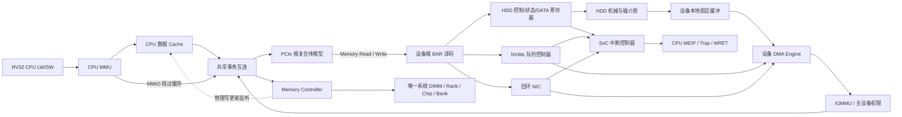

# I/O 系统：按现有六阶段计划跑通硬件

在仓库根目录运行：

```bash
bash tests/run_io.sh
```

脚本编译 I/O 测试和 `examples/io_modes.cpp`，使用 C++17、`-Wall -Wextra -Wpedantic -Werror`。
示例的四次运行均由模拟 RV32 CPU 执行 Guest 机器码，读取同一磁盘扇区到系统 DIMM。
查询与 PIO 中断各搬运 128 个数据字；DMA 查询与 DMA 中断各通过设备主设备事务传输 512 字节。
四份结果逐字节比较。PIO 中断产生 128 次服务，DMA 中断产生一次完成服务。
模拟周期随教学参数而定，不能换算成真实硬件性能。

## 六阶段落点与验收

| 计划阶段 | 当前实现 | 可执行验证 |
|---|---|---|
| 1. CPU → MMIO | 现有 `RV32Core` 的 LW/SW → CPU MMU → 共享互连按物理地址选设备 → 寄存器 | `io_polling_test` 的 Busy/Ready、过早 DATA 访问；`io_fault_test` 的非法宽度与地址 |
| 2. 程序查询 | 机械 HDD 外接教学寄存器控制器；命令接收后按 tick 推进，DATA 握手传一个字 | Guest 轮询并 LW DATA / SW DIMM，完整数据比较；另验证 PIO 写盘 |
| 3. 中断 | 设备 IRQ → SoC 屏蔽/判优/claim → CPU MEIP → 指令边界进入 Trap → Guest ISR → MRET | `io_interrupt_test` 验证 128 次中断、GPR/栈恢复和继续执行；`io_fault_test` 验证延迟 Load 中不得提前响应 |
| 4. DMA | 描述符、方向、地址/长度计数器、一个在途事务、返回确认、背压、错误 | `io_dma_test` 验证无 Guest 数据复制循环、双向 DMA、非整字尾部、IOMMU、禁止 DMA 访问 MMIO |
| 5. NVMe | CAP/CC/CSTS/AQA/ASQ/ACQ、Doorbell、Admin Create CQ/SQ、64B SQE、16B CQE、NVM Read/Write | `nvme_test` 的 Guest 初始化/提交/查询；环回绕、Phase、CID、IRQ；`io_fault_test` 的 PRP2 与错误完成 |
| 6. 并发与 Guest | CPU、HDD、NVMe、回环 NIC 的独立主设备 ID，共享延迟事务与一份 DIMM；Guest 驱动运行于 RV32 流水线及两种多周期控制器 | `io_integration_test` 同时进行 CPU LW/SW、HDD DMA、NVMe DMA 与 NIC DMA；确认每个 master 获得服务 |

这是六阶段的可运行教学闭环。NVMe、PCIe、IOMMU、NIC 的完整工业协议不在此闭环范围内，边界列在后文。

## 组件与真实数据路径



PIO 的 DATA 访问经过 CPU，由 Guest 的下一条 SW 写入主存。DMA 则由设备自己的状态机提交事务。
`DmaEngine` 只有描述符、设备缓冲和返回数据，没有另建主存数组。
NVMe 的 SQ/CQ、数据缓冲和 NIC 的 TX/RX 缓冲都位于同一份 DIMM。

原 HDD 的 `submit_read/write`、内部 `DMA` 与磁介质事件模型保留，原有机械实验无需改调用。
新 `hdd::IOController<HDD>` 独占这份机械设备，把原独立模型的完成向量作为**适配器本地扇区缓冲**。
它不会把这份向量当系统物理内存；新 `hdd::BusDMA` 才负责跨系统总线的传输。
系统运行期间不要从宿主并行调用这份 HDD 的 `submit_*` 或取走其完成事件。

## 时钟、仲裁、缓存

`Simulator<SoC>::step()` 只调用一次 `SoC::tick()`。一个系统 tick 的顺序固定：

1. 共享总线处理旧请求，提交寄存器/内存数据拍，产生响应。
2. CPU 数据 Cache 控制器消费已返回的行填充、写穿或 MMIO 响应。
3. HDD、NVMe、NIC 各推进一次控制器和 DMA；新事务只排队。
4. 采样 SoC 中断线，CPU 执行一拍；缓存命中可直接返回，下级事务只排队。

主设备从不自行 tick 总线，也不在 DMA 内部运行 CPU。请求最早下一系统 tick 才能获得服务。
共享互连的 `Fabric` 位于 `interconnect/fabric.hpp`，实现按 master 轮转、每 master FIFO、tag、准备延迟和分离事务。
默认主存准备延迟为两拍；流水线等待返回时保持 MEM 及上游，WB 可排空，
同一请求不会重复读取有副作用的 DATA。多周期执行继续保持原访存微状态。
CPU 算术指令可以在 DMA 请求等待期间正常推进。当前没有实现三种主存共享策略的运行时切换。

**当前 SoC 默认在 CPU MMU 后接写穿数据 Cache。** 普通 RAM 读命中不占用总线，
读缺失通过共享总线取得一整行；CPU 写等待主存确认，写缺失不分配。MMIO 始终走原始设备事务。
`Memory` 的物理写监听会把 CPU、DMA 和宿主写入同步更新到已有缓存行；填充过程中也保留
交错写入的最新字节，避免先返回的旧字节污染整行。DMA 自身仍直接访问同一份 DIMM。
这是单核、写穿、无写缓冲条件下的教学写更新协议，不支持写回缓存或多核一致性。
配置 `SoCConfig.enable_data_cache=false` 可复现原来的直连路径，详见 [CPU Cache](cpu-cache.md)。

取指仍使用现有 Harvard 指令 ROM，数据、设备寄存器和 DMA 使用物理主存通路。
检查系统数据使用 `system.memory()`；`cpu.memory()` 是未接总线时的独立 Core 实验后备存储，并非该 SoC 的主存。
HDD 的 `tick_ms` 只是机械时间与教学时钟的比例参数，不是总线或 CPU 的真实频率。

## 地址与协议

两种整机模型共用 [板级 MMIO 地址表](../soc/address_map.hpp)。`SoC` 和 SystemC `Platform` 在构造时按表登记目标。
运行时，`interconnect/fabric.hpp` 中的 `Fabric::decode_address()` 按物理地址选中 RAM 或设备窗口。
RAM 请求交给内存控制器。HDD、NVMe 和 NIC 的 MMIO 窗口接到 PCIe 根复合体模型；片上外设仍直接接在互连上。

例如 RV32 执行 `sw x6, 12(x5)`，其中 `x5 = 0x10000000`，`x6 = 7`。
在裸地址模式下，互连根据 `0x1000000C` 选中 HDD 的 PCIe 窗口。根复合体将请求转换为
`MemoryWrite{0x1000000C, 7}`，HDD 设备端的 `BarEndpoint` 检查完整的四字节访问是否落在自己的 BAR 内，
减去 BAR 基地址得到 `0x0C`。HDD 控制器的 `case Lba` 选中 LBA 寄存器并写入 `7`。

此模型支持对齐的单 DWORD Memory Read 和 Memory Write。BAR 由板级地址表静态配置；
事务用 C++ 对象传递，省略二进制 TLP 编码、配置空间枚举和物理链路。模拟总线照常向发起者返回事务结果。
`pcie_mmio_test` 运行上述 RV32 指令并读回 LBA，同时验证越过 BAR 的请求不影响寄存器。

**共享事务互连与 NoC：** 本项目的 `Fabric` 是模拟地址路由、仲裁和事务定时的共享互连，
并未实现 NoC 的路由器、网络拓扑和链路，不能仅因它连接片上部件就称为 NoC。
CPU 内部寄存器与 ALU 之间的数据通路属于另一层；CPU 发出的系统访存请求才进入这里的互连。

| 物理窗口 | 用途 |
|---|---|
| `0x00000000..0x0003FFFF` | 默认四 Rank、256 KiB DIMM（每 Rank 64 KiB）；可通过 `SoCConfig.memory` 配置 |
| `0x10000000..0x100000FF` | 教学 HDD 寄存器 |
| `0x10001000..0x100010FF` | SoC 中断控制器 |
| `0x20000000..0x20001FFF` | NVMe 寄存器与两对 Doorbell |
| `0x30000000..0x300000FF` | 回环 NIC |

MMIO 只接受一次对齐的 32 位访问。窗口不得重叠；设备地址不会通过截低位别名到 DIMM。
主设备 0 为 CPU，1/2/3 为 HDD/NVMe/NIC。设备 DMA 无论 IOMMU 是否启用，都只能访问 RAM，
不得访问设备寄存器。IOMMU 禁用时使用物理地址；启用时按 master、IOVA 范围、R/W 权限翻译，
默认拒绝，验证完整的每笔事务范围。大描述符由多个事务组成，后续事务失败时可能已提交前缀；
DMA 进度记录已确认的字节，不把部分传输报告为完成。

### 教学 HDD

| 偏移 | 名称 | 协议 |
|---|---|---|
| `0x00` | COMMAND | 1=Read，2=Write；忙时拒绝重编程 |
| `0x04` | STATUS | Busy=1，DataReady=2，Completed=4，Error=8；Idle=0 |
| `0x08` | DATA | PIO 每次读/写最多 4 字节，小端；未就绪访问报错 |
| `0x0C` | LBA | 当前模型一次一个物理扇区 |
| `0x10` | LENGTH | 字节数，必须等于扇区长度 |
| `0x14/0x20` | DMA_ADDRESS low/high | DMA 的主机物理地址或 IOVA |
| `0x18` | CONTROL | bit0=IRQ enable，bit1=DMA enable |
| `0x1C` | IRQ_STATUS | bit0=事件待处理；写 1 确认设备事件 |
| `0x24` | PROGRESS | PIO/DMA 已确认的数据字节数 |
| `0x28` | ERROR_CODE | 0=无错误，1=错误；宿主诊断可用 `error()` |

状态为 Idle → CommandAccepted → Busy → DataReady（PIO）/DMA → Completed，失败进入 Error。
Read 先读取介质再送出数据，Write 先接收数据再写介质。PIO 缓冲不会自行流入主存。
PIO 中断在数据就绪时发出，DMA 中断在整批传输完成后发出。
PIO 中断事件未确认前，不开放下一字，避免确认与下一数据事件互相覆盖。

### 中断与 RV32

中断控制器偏移 0/4/8/12 分别为 PENDING/MASK/CLAIM/COMPLETE。
source 1..31；MASK 的位为 1 表示屏蔽；多个请求按较小 ID 先响应。
CLAIM 读取选定来源并标记在服务；先确认设备，再写 COMPLETE，未撤销的电平会重新挂起。
中断控制器与设备控制器是两个对象。

RV32 支持六种 Zicsr、MRET、WFI、FENCE/FENCE.I，流水线和两种多周期控制器均可执行。
流水线在 WB 串行提交 CSR/MRET；中断冲刷未提交指令，已发出的访存先完成并退休，
再保存下一条架构 PC。更年轻的错误路径 MMIO 不会发出。详见 [流水线说明](../soc/rv32/pipeline/README.md)。
实现 M/U 模式下 `mstatus`、`mie`、`mtvec`、`mscratch`、`mepc`、`mcause`、`mtval`、`mip` 和 16 项 PMP 子集。
机器外部中断 cause=11；支持 mtvec Direct/Vectored，进入时清 MIE、保留 MPIE、保存下一指令 PC；
MRET 恢复 PC、MIE 与 MPP 指定的 M/U 模式；返回后 MPP 置 U。没有 S-mode 或异常委托。
SystemC 平台另有直连 CPU 的 CLINT 软件/定时中断（cause=3/7），不经过上述外部中断控制器。
WFI 期间外设、DMA 和时间继续运行；局部已使能的 pending 输入可以唤醒 CPU。
GPR 由 Guest ISR 显式压栈/恢复，不替软件自动保存。软件若重开中断并嵌套，须自行保存 CSR 现场。
独立教学 SoC 的同步故障默认通过精确 `RV32Fault` 交给宿主。
[SystemC 平台](SYSTEMC_PLATFORM.md)默认将同步故障和 ECALL/EBREAK 交给机器态异常处理程序，
各执行路径均可通过 Core 构造参数选择这两种策略。

### NVMe 与 NIC

NVMe 保留标准布局的寄存器偏移、SQE/CQE、CID、SQHD/SQID、Phase 和 Doorbell 语义。
Guest 先设置 Admin 队列、CC，再提交 Create CQ(05h)/Create SQ(01h)，随后向 QID=1 提交
NVM Read(02h)/Write(01h)。SQE 获取、数据和 CQE 写回全部使用设备 DMA 主设备。
CQE 最后一个字的状态/Phase 随数据拍写入；IRQ 直到 CQ 写入被确认才产生。
CQ head Doorbell 释放完成并清除相应电平中断；INTMS/INTMC 提供 bit0 中断屏蔽。

边界：一个命名空间 NSID=1，一对 I/O 队列 QID=1；队列深度 2..16、4 KiB 对齐且连续，
SQ/CQ 都保留一个空槽；512B 逻辑块，单次最多 4 KiB，PRP1 可带 DWORD 对齐偏移，跨页时使用 PRP2，
无 PRP list/SGL。Admin 参数错误使用简化的通用错误码；不实现 Identify、队列删除、FTL、擦除/寿命、
MSI-X、PCIe 枚举或 PHY。队列获取/CQ 写回 DMA 失败进入 CFS，数据 DMA 失败写回错误完成。
禁用须先静止；忙时拒绝禁用，避免遗留 DMA 在下一次启用后偷偷写入。
`Version` 的 1.4 值只标识所参照布局，不代表通过 NVMe 一致性认证。

NIC 为教学回环设备：CPU 配置 TX_ADDRESS/RX_ADDRESS/LENGTH 后写 COMMAND=1；
设备 DMA 读 TX，再 DMA 写 RX，STATUS 1/2/4 表示 Busy/Done/Error，IRQ 写 1 清除。
它用于证明第三个独立 DMA master 能与 CPU/NVMe/HDD 同时获得共享总线，不模拟以太网收发。

## Guest 与测试入口

`examples/guest/io_driver.hpp` 的小汇编器生成真实 RV32 指令，常量池由 Guest LW 读取。
宿主仅装载 ROM、常量、磁盘镜像并推进时间；运行中的 COMMAND、DATA、队列提交与确认由 Guest 完成。
`hdd_read()` 展示四种搬运/通知组合；`nvme_read()` 由 Guest 写出完整 SQE、敲 Doorbell、查询 CQ，
最后由 CPU LW 从 DMA 写入的 DIMM 读回第一字。
单元/故障测试另用宿主发起寄存器事务，便于控制特定硬件时序；不能与 Guest 验证混称。

| 测试 | 主要检查 |
|---|---|
| `io_polling_test.cpp` | RV32 流水线及两种多周期控制器、查询/PIO、忙状态、无隐式 DMA |
| `io_interrupt_test.cpp` | Guest ISR/MRET、GPR/栈恢复、屏蔽/判优/确认/再次挂起 |
| `io_dma_test.cpp` | DMA 查询/中断、Guest 无逐字复制、非整字尾、IOVA/权限/越界 |
| `nvme_test.cpp` | 三种执行配置的 Guest、双向 I/O、CID、队列回绕、Phase、无效 LBA |
| `io_integration_test.cpp` | 真正执行 LW/SW 的 CPU 与三个设备 DMA 同时访问唯一 DIMM |
| `io_fault_test.cpp` | PIO/DMA 写盘、错误恢复/掉电、PRP2、SQ/CQ 故障、CQ 背压、向量入口、精确故障、请求队列背压 |

## 逐图阅读与来源边界

下面是本次用户提供的原始图；页码是图片中可见的**教材印刷页**，不是 PDF 页。
截图工具栏覆盖的行不补造；图片中的勾选、涂改和计算保留为原图内容，不据此推断掌握。

| 图 | 原文件（`transporter/data/uploads/`） | 读到的主要内容 |
|---|---|---|
| 1 | `1794667049439_679b131f.jpg` | p294：地址译码/设备选择、握手、数据缓冲、命令与状态；三类寄存器与总线图 |
| 2 | `1794667052287_cdba4774.jpg` | p299：查询六步、独占/定时查询；4B/2MB/s=2us 的服务间隔 |
| 3 | `1794667055513_b9af618b.jpg` | p300–301 开头：程序中断与并行；40MB/s 下每字 0.1us 小于中断处理 0.8us |
| 4 | `1794667057578_cd9be181.jpg` | p301–302：指令完成边界、关中断、PC/PSW 保存、向量入口、软件保存现场与返回 |
| 5 | `1794667059294_8cbace8e.jpg` | p303–304：单重/多重中断，屏蔽位为 1 的含义；响应优先级和处理优先级的区别 |
| 6 | `1794667061070_c0d916d4.jpg` | p304–305：A/B/C/D 屏蔽例与执行轨迹；进入 DMA 特点：数据传送无需 CPU 执行复制 |
| 7 | `1794667062757_037980c6.jpg` | p305–306：DMAC 地址/长度计数器、数据寄存器、请求/响应与完成中断 |
| 8 | `1794667064577_e18d7ea3.jpg` | p306–308 开头：停止 CPU、周期挪用、交替访存三种共享策略及其边界 |
| 9 | `1794667069127_980af2bf.jpg` | p308–309 开头：1000B/块、40MB/s、预后处理 500 周期的 4% 例；预处理/传送/后处理流程 |
| 10 | `1794667070974_1c5f2703.jpg` | p308–309：DMA 与程序中断的区别；题 01～03 可见选项与手写选择 |

实现取本次附带计划的六阶段范围：三种 I/O 方式、真实总线、IRQ、NVMe 与并发。
屏蔽字例题的完整嵌套实验、三种 DMA 总线策略切换和数值效率题并未伪装为已实现的功能。

外部规范用于校对布局和机器语义，教学 HDD 寄存器不冒充 NVMe 协议：

- [RISC-V Machine-Level ISA](https://docs.riscv.org/reference/isa/priv/machine.html)：机器外部中断、mepc/mtvec、MIE/MPIE、MPP 与 MRET。
- [NVM Express Base 2.0e](https://nvmexpress.org/wp-content/uploads/NVM-Express-Base-Specification-2.0e-2024.07.29-Ratified.pdf)：队列、Create CQ/SQ、完成项与 Phase。© 2008 to 2024 NVM Express, Inc. ALL RIGHTS RESERVED.
- [控制器寄存器布局（Microsoft NVMe 定义）](https://learn.microsoft.com/en-us/windows/win32/api/nvme/ns-nvme-nvme_controller_registers)：CAP/CC/CSTS/AQA/ASQ/ACQ 和中断屏蔽寄存器偏移。
